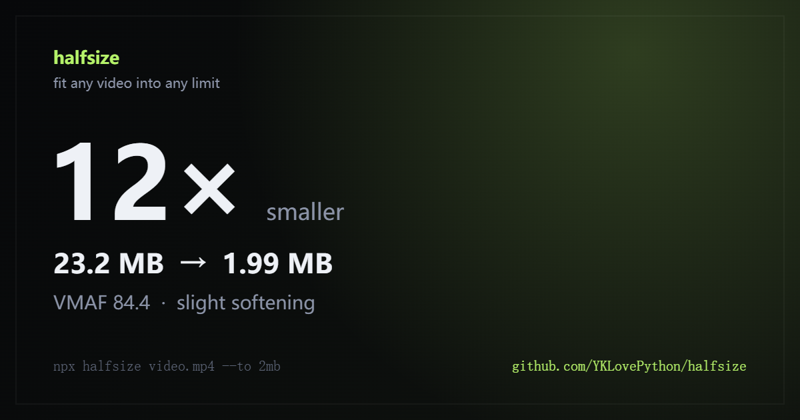
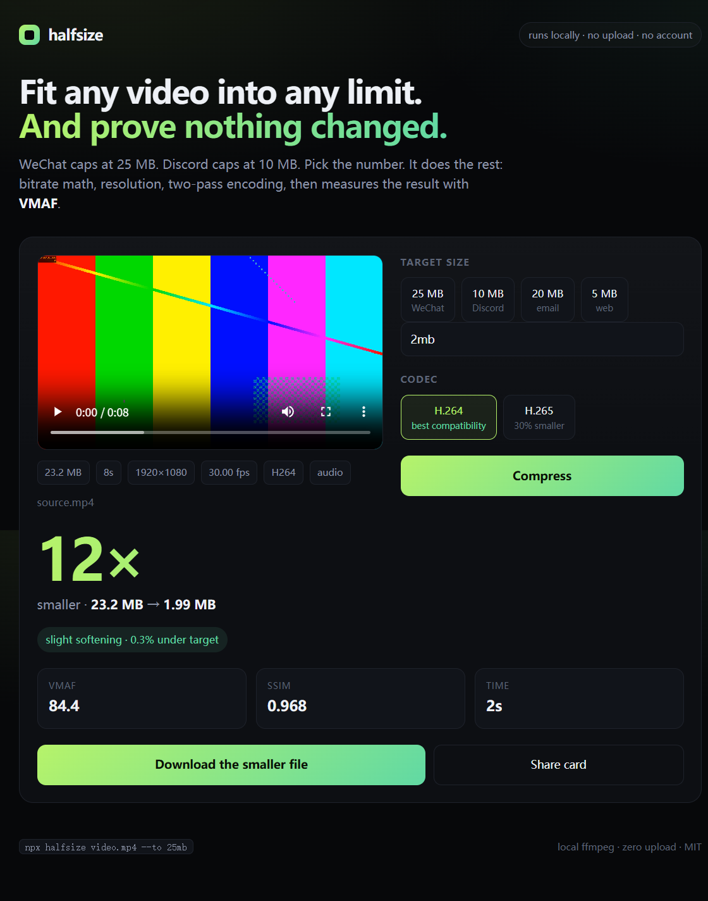

<p align="center">
  
</p>

<h1 align="center">halfsize</h1>

<p align="center">
  <b>Fit any video into any size limit. Locally. And prove the quality survived.</b>
</p>

<p align="center">
  <a href="https://www.npmjs.com/package/halfsize"></a>
  <a href="https://www.npmjs.com/package/halfsize"></a>
  <a href="LICENSE"></a>
  
  
</p>

<p align="center">
  <a href="README.zh-CN.md">中文说明</a> ·
  <a href="#quick-start">Quick start</a> ·
  <a href="#how-it-works">How it works</a> ·
  <a href="#faq">FAQ</a>
</p>

---

WeChat refuses anything over **25 MB**. Discord gives you **10 MB**. Email chokes around **20 MB**.
So you open a video editor, guess a bitrate, export, check the size, export again, and still
can't tell whether the picture got worse.

`halfsize` turns that into one command:

```bash
npx halfsize wedding.mp4 --to 25mb
```

It computes the bitrate, picks the resolution that actually fits, encodes twice, then measures
the result with **SSIM** and **VMAF** so you know whether it still looks the same.

```
  halfsize 0.1.0

  source.mp4
  23.2 MB  8s  1920x1080  30.00 fps  h264

  target     2.00 MB
  plan       H.264  960x540  1.81 Mbps  audio 128 kbps  2-pass
  scale      1920x1080 -> 960x540
  estimate   1.94 MB  (12x smaller)
  output     source.2mb.mp4

  measuring quality                                        done in 2s

  23.2 MB  ->  1.99 MB   12x smaller   0.3% under target
  VMAF 84.4   SSIM 0.968   slight softening

  -> C:\Videos\source.2mb.mp4
```

## Why this exists

"Make it smaller" is a solved problem. **"Make it fit in exactly 25 MB, and tell me if it
still looks right"** is the part every tool makes you guess at.

- HandBrake is excellent, but it asks you to think in codecs, RF values, and presets.
- Online compressors work until you remember you just uploaded a private video to a stranger.
- `ffmpeg` can do all of this. Nobody remembers the 11 flags, and almost nobody checks VMAF afterwards.

`halfsize` is the missing 5%: a target size you type, and a quality score you can read.

| | halfsize | HandBrake | Online compressors |
|---|---|---|---|
| Fit an exact size | ✅ one flag | manual bitrate math | usually re-encodes blindly |
| Tells you the quality cost | ✅ VMAF + SSIM | ❌ | ❌ |
| Your file stays on your machine | ✅ | ✅ | ❌ |
| Scriptable / CI friendly | ✅ CLI + JSON | ❌ GUI | ❌ |
| Learns a new UI | no | yes | yes |

## Quick start

Requires [Node.js 18+](https://nodejs.org). FFmpeg is bundled on first install; if it cannot
be downloaded, `halfsize` uses your system install instead.

```bash
# compress to a size
npx halfsize video.mp4 --to 25mb

# smaller file, same quality budget
npx halfsize video.mp4 --to 10mb --codec h265

# quality-first mode when size does not matter
npx halfsize video.mp4 --crf 23

# preview the plan without encoding
npx halfsize video.mp4 --to 25mb --dry-run

# machine-readable, for scripts
npx halfsize video.mp4 --to 25mb --json
```

> While the npm release is being finalized, the same commands work straight from this repo:
> `npx github:YKLovePython/halfsize video.mp4 --to 25mb`

Install it globally if you will use it more than once:

```bash
npm install -g halfsize
```

### The local web app

```bash
npx halfsize --web
```

Opens `http://127.0.0.1:4174` — drag a video in, pick 25 MB / 10 MB / 20 MB / 5 MB or type
your own limit, and watch the encode. The file goes to a temporary folder **on your own
machine**; nothing is sent anywhere.

<p align="center">
  
</p>

After each run you can download a **share card** (the image at the top of this README) with the
real numbers on it.

## How it works

1. **Probe.** Read duration, resolution, frame rate, audio bitrate, rotation, and HDR metadata.
2. **Budget.** Total bitrate = target bytes × 8 ÷ duration, minus audio, minus a small
   container overhead.
3. **Pick a resolution.** Walk a ladder from the source size down to 240p and choose the
   largest one whose pixels fit the budget at that codec's bits-per-pixel target
   (H.264: 0.072 bpp, H.265: 0.045 bpp). This is why a 12× shrink still looks reasonable:
   the encoder gets to spend its bits on fewer pixels.
4. **Encode twice.** Two-pass ABR with `libx264` or `libx265`. Pass one learns where the bits
   are needed; pass two spends them. Output is `yuv420p`, AAC audio, `+faststart`, and tagged
   `hvc1` for H.265 so it plays on Apple devices.
5. **Prove it.** Sample three points in the video, compute SSIM at each, and VMAF at the
   midpoint. Compare against thresholds and print a verdict in plain language.

```
VMAF ≥ 95  indistinguishable
VMAF ≥ 90  looks the same
VMAF ≥ 80  slight softening
VMAF ≥ 70  visible loss
below 70   clearly degraded
```

VMAF is Netflix's perceptual metric; it correlates with human judgement far better than PSNR
or bitrate. It is not magic, but it is a much better answer than "trust me".

## CLI reference

```
halfsize <file> [options]

  --to <size>       Target size: 25mb, 700k, 1.5gb
  --crf <n>         Quality mode instead of size mode (18 best, 23 balanced, 28 small)
  --codec <name>    h264 (default, maximum compatibility) or h265 (about 30% smaller)
  --preset <name>   ultrafast .. veryslow (default: medium)
  --out <file>      Output path
  --no-verify       Skip SSIM/VMAF
  --no-downscale    Never reduce resolution (the target may then be missed)
  --json            Machine-readable result
  --dry-run         Print the plan, do not encode
  --web             Start the local web app
  --doctor          Show which FFmpeg and encoders were found
  -h, --help        Help
  -v, --version     Version
```

Sizes accept `b`, `k`/`kb`, `m`/`mb`, `g`/`gb`, with or without a space. No unit means MB.

Exit codes: `0` success, `1` error. `--json` returns the plan, the measured quality, and the
target accuracy, which makes it easy to wrap in a script.

## Install notes

`ffmpeg-static` and `ffprobe-static` download prebuilt binaries during `npm install`. If you are
behind a proxy or a TLS-inspecting network, that download can fail. `halfsize` then falls back
to any `ffmpeg` on your `PATH`, or to a build you point at explicitly:

```bash
HALFSIZE_FFMPEG=/path/to/ffmpeg HALFSIZE_FFPROBE=/path/to/ffprobe npx halfsize video.mp4 --to 25mb
```

On Windows, `winget install Gyan.FFmpeg` is enough. On macOS, `brew install ffmpeg`. On
Debian/Ubuntu, `sudo apt install ffmpeg`. Run `npx halfsize --doctor` to see what was found.

## FAQ

**Does my video get uploaded?**
No. The CLI never touches the network. The web app talks only to `127.0.0.1`, and uploaded
files go to a temp directory that is deleted when the process exits.

**Why did it lower my resolution?**
Because 25 MB of 4K is not enough bits to look good. Lowering resolution and keeping the
bitrate per pixel sane almost always looks better than keeping 4K and starving it. Use
`--no-downscale` if you want to override that.

**Why is the output slightly under the target, not exactly on it?**
Container overhead and two-pass ABR both vary a little. `halfsize` aims ~3% under so it never
overshoots a hard platform cap. In the example above it landed 0.3% under.

**H.264 or H.265?**
H.264 plays everywhere, including old Android phones and browsers. H.265 is roughly 30% smaller
at the same quality but can be awkward in some editors and older hardware. Default is H.264.

**Does it work on Windows / macOS / Linux?**
Yes. It is plain Node.js and FFmpeg.

**Can I batch a folder?**
Not built in yet. A shell loop works today:

```bash
for f in *.mp4; do npx halfsize "$f" --to 25mb; done
```

**Why "halfsize"?**
Because the honest answer to "how much smaller will it get?" is usually "about half, or a lot
more than half". The tool reports the real number either way.

## Roadmap

- Hardware encoding (NVENC / QSV / VideoToolbox) as an opt-in fast path
- Batch mode and a folder watcher
- Subtitle and multiple audio track passthrough
- HDR-to-SDR tonemapping, so iPhone HDR clips keep their colors
- AV1 (`libsvtav1`) when the source is already AV1-friendly
- A single-file binary, so Node.js is not required
- Presets for specific platform caps (WeChat, Discord, email, X, Bluesky)

If you want one of these, open an issue and say which. Pull requests are welcome; see
[CONTRIBUTING.md](CONTRIBUTING.md).

## Development

```bash
git clone https://github.com/YKLovePython/halfsize.git
cd halfsize
npm install
npm test
node bin/halfsize.mjs --web
```

The test suite includes a real end-to-end encode: it generates a clip with FFmpeg, compresses
it to a target, probes the output, and asserts the size and SSIM. No fixtures in the repo.

## License

MIT. Use it, fork it, ship it.

---

If `halfsize` saved you from guessing a bitrate, a star helps the next person find it.
