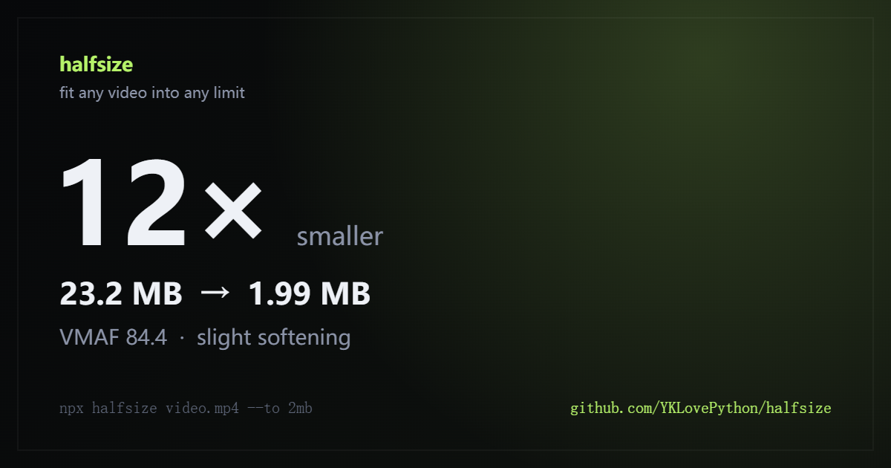
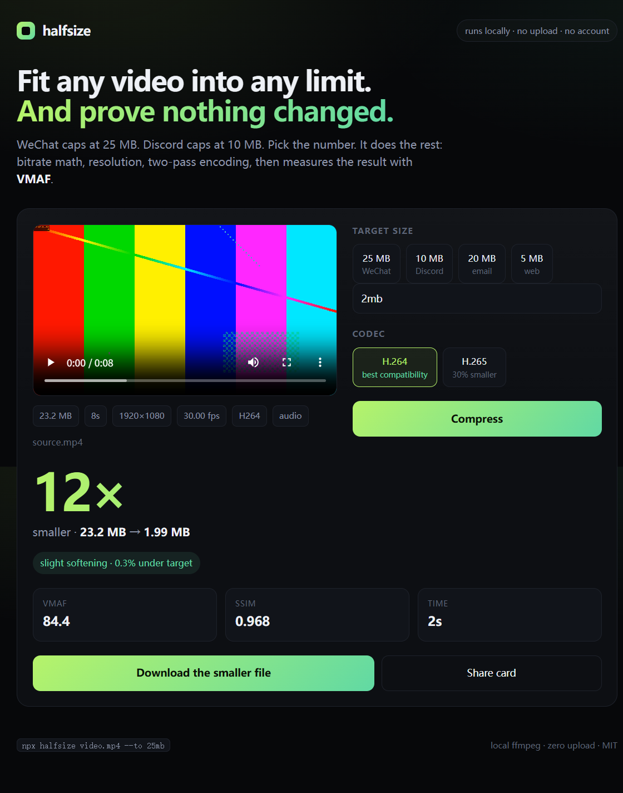

<p align="center">
  
</p>

<h1 align="center">halfsize</h1>

<p align="center">
  <b>把任何视频塞进任何大小限制。全程本地。并且证明画质没垮。</b>
</p>

<p align="center">
  <a href="https://www.npmjs.com/package/halfsize"></a>
  <a href="https://www.npmjs.com/package/halfsize"></a>
  <a href="LICENSE"></a>
  <a href="https://github.com/YKLovePython/halfsize/actions/workflows/test.yml"></a>
  
  
</p>

<p align="center">
  <a href="README.md">English</a> ·
  <a href="https://YKLovePython.github.io/halfsize/zh/">官网与教程</a> ·
  <a href="#快速开始">快速开始</a> ·
  <a href="#它怎么工作">它怎么工作</a> ·
  <a href="#常见问题">常见问题</a>
</p>

---

微信和 Discord 都只让发 **20 MB**，邮件也大多卡在 **20 MB**。
于是你打开剪辑软件，猜一个码率，导出，看一眼大小，再导一次——最后还是不知道画质到底掉了多少。

`halfsize` 把这件事变成一行命令：

```bash
npx halfsize 婚礼.mp4 --to 25mb
```

它会算码率、挑一个真正塞得下的分辨率、做两遍编码，最后用 **SSIM** 和 **VMAF** 测给你看：
画质到底还在不在。

```
  halfsize 0.1.5

  source.mp4
  23.2 MB  8s  1920x1080  30.00 fps  h264

  target     2.00 MB
  plan       H.264  960x540  1.81 Mbps  audio 128 kbps  2-pass
  scale      1920x1080 -> 960x540
  estimate   1.94 MB  (12x smaller)
  output     source.2mb.mp4

  measuring quality                                        done in 1s

  23.2 MB  ->  1.99 MB   12x smaller   0.4% under target
  VMAF 84.4   SSIM 0.968   slight softening

  -> C:\Videos\source.2mb.mp4
```

## 为什么做这个

「把视频变小」早就有人解决了。真正没人做好的是：**「刚好塞进 20 MB，然后告诉我画质还行不行」**。

- HandBrake 很好用，但它要你想清楚编码器、RF 值、preset 这些词。
- 在线压缩网站也能用，直到你想起自己刚把私人视频传给了陌生人。
- `ffmpeg` 当然做得到，只是没人记得那 11 个参数，而且几乎没人压完再测一遍 VMAF。

`halfsize` 补的就是这最后 5%：你输入一个目标大小，它给你一个看得懂的画质分数。

| | halfsize | HandBrake | 在线压缩 |
|---|---|---|---|
| 精确压到指定大小 | ✅ 一个参数 | 要自己算码率 | 通常只是盲压 |
| 告诉你画质代价 | ✅ VMAF + SSIM | ❌ | ❌ |
| 文件留在本机 | ✅ | ✅ | ❌ |
| 能写进脚本 / CI | ✅ CLI + JSON | ❌ 图形界面 | ❌ |
| 需要重新学一套界面 | 不用 | 要 | 要 |

## 快速开始

需要 [Node.js 18+](https://nodejs.org)。首次安装会下载 FFmpeg；下载失败时会自动使用你系统里已有的 FFmpeg。

```bash
# 压到指定大小
npx halfsize video.mp4 --to 25mb

# 或者直接说你要传到哪里
npx halfsize video.mp4 --for discord

# 一次压好几个
npx halfsize clip1.mp4 clip2.mp4 clip3.mp4 --to 10mb

# 更小的文件，H.265
npx halfsize video.mp4 --to 10mb --codec h265

# 不在乎大小，只想要好画质
npx halfsize video.mp4 --crf 23

# 只看方案，不真的压
npx halfsize video.mp4 --to 25mb --dry-run

# 给脚本用的 JSON
npx halfsize video.mp4 --to 25mb --json
```

常用的话装到全局：

```bash
npm install -g halfsize
```

### 本地网页版

```bash
npx halfsize --web
```

打开 `http://127.0.0.1:4174`，把视频拖进去，选 20 MB / 16 MB / 5 MB，或者自己输入一个数，
然后看着它压。文件只会写进**你自己电脑**的临时目录，不会发到任何地方。

<p align="center">
  
</p>

每次压完可以生成一张**分享图**（就是本文最上面那张），上面是这次真实的数字。

附实测画质的分平台教程：
[微信 20 MB](https://YKLovePython.github.io/halfsize/zh/wechat/) ·
[任意 20 MB 限制](https://YKLovePython.github.io/halfsize/zh/20mb/) ·
[Discord 20 MB](https://YKLovePython.github.io/halfsize/discord/) ·
[WhatsApp 16 MB](https://YKLovePython.github.io/halfsize/whatsapp/) ·
[本地压缩不上传](https://YKLovePython.github.io/halfsize/zh/offline/)。

### 给 agent 用

仓库里带了 [`skills/halfsize/SKILL.md`](skills/halfsize/SKILL.md)。把整个文件夹放进你的
agent 技能目录（Claude Code 是 `.claude/skills/halfsize/`），agent 就能把「把这个视频压到
25 MB」变成一次压缩加一份画质报告，而不是瞎猜码率。

## 它怎么工作

1. **探测。** 读取时长、分辨率、帧率、音频码率、旋转信息、HDR 标记。
2. **算预算。** 总码率 = 目标字节 × 8 ÷ 时长，减掉音频，再留一点容器开销。
3. **选分辨率。** 从原分辨率开始，沿着 2160p → 240p 的阶梯往下走，挑「按这个编码器每像素比特数
   （H.264 0.072 bpp，H.265 0.045 bpp）刚好塞得下」的最大一档。这就是 12 倍压缩还能看的原因：
   让编码器把有限的比特花在更少的像素上，而不是硬撑 4K。
4. **压两遍。** `libx264` 或 `libx265` 两遍 ABR。第一遍找出哪里需要比特，第二遍把比特花在那里。
   输出 `yuv420p`、AAC 音频、`+faststart`，H.265 额外打 `hvc1` 标签，保证苹果设备能播。
5. **证明。** 在视频里取三个采样点算 SSIM，在中间点算 VMAF，对照阈值给一句人话结论。

```
VMAF ≥ 95  几乎看不出差别
VMAF ≥ 90  看起来一样
VMAF ≥ 80  轻微变软
VMAF ≥ 70  能看出损失
低于 70    明显变差
```

VMAF 是 Netflix 提出的感知质量指标，比 PSNR 或「码率多少」更接近人眼判断。
它不是魔法，但比「相信我」靠谱得多。

## 各档大小到底损失多少画质

同一个 60 秒 1080p 视频，默认设置，在普通笔记本上实测：

| 目标 | 输出 | 分辨率 | 视频码率 | VMAF | 结论 |
|---|---|---|---|---|---|
| 20 MB | 19.45 MB | 1280×720 | 2.46 Mbps | 88.3 | 轻微变软 |
| 16 MB | 15.59 MB | 960×540 | 1.94 Mbps | 84.8 | 轻微变软 |
| 10 MB | 9.77 MB | 960×540 | 1.17 Mbps | 82.9 | 轻微变软 |
| 5 MB | 4.93 MB | 640×360 | 0.55 Mbps | 72.0 | 能看出损失 |

源片：60 秒、1920×1080、30fps、18 Mbps H.264（136 MB）。VMAF 在中间点对着源片测量，
SSIM 取三个采样点。实际数字会随内容变化：新闻口播会好很多，满屏彩纸会差很多。

20 MB 这一档是故意降到 720p 的：60 秒 1080p 给 2.4 Mbps，还不如把同样的比特给 720p。
想强制保分辨率就加 `--no-downscale`；播放器支持的话，`--codec h265` 能在同尺寸下多换约 30% 画质。

## 命令行参数

```
halfsize <file> [options]

  --to <size>       目标大小：25mb、700k、1.5gb
  --for <app>       按平台上限：discord、whatsapp、wechat、email、twitter
  --crf <n>         质量模式，不按大小（18 最好，23 均衡，28 更小）
  --codec <name>    h264（默认，兼容性最好）或 h265（大约再小 30%）
  --preset <name>   ultrafast .. veryslow（默认 medium）
  --out <file>      输出路径
  --no-audio        去掉音轨
  --no-verify       跳过 SSIM/VMAF 检测
  --no-downscale    绝不降分辨率（可能会压不到目标）
  --json            机器可读结果
  --dry-run         只打印方案，不编码
  --web             启动本地网页版
  --port <n>        网页版端口（默认 4174）
  --doctor          查看找到的 FFmpeg 和编码器
  -h, --help        帮助
  -v, --version     版本
```

大小支持 `b`、`k`/`kb`、`m`/`mb`、`g`/`gb`，中间可以有空格。不写单位按 MB 算。

`--for` 用的是当前免费档上限（2026 年 11 月核对）：`discord` 20 MB、`whatsapp` 16 MB、
`wechat` 20 MB、`email` 20 MB、`twitter` 512 MB。平台上限会变，写死不如随时用 `--to` 覆盖。

退出码：`0` 成功，`1` 出错。`--json` 会返回方案、画质测量和目标误差，方便包进脚本。

## 安装说明

需要 Node.js 18 或更高版本。第一次 `npx` 会同时下载包和一个预编译的 FFmpeg，可能要等一会儿。
如果你会反复用，直接全局安装，之后每次启动都不用再等：

```bash
npm install -g halfsize
halfsize video.mp4 --to 25mb
```

如果 `npx` 总是启动旧缓存，用 `npx halfsize@latest ...` 指定最新版。

`ffmpeg-static` 和 `ffprobe-static` 会在 `npm install` 时下载预编译二进制。如果你在公司代理或
会拦截 TLS 的网络后面，这一步可能失败。`halfsize` 会退回到 `PATH` 里的 `ffmpeg`，或者你手动指定的版本：

```bash
HALFSIZE_FFMPEG=/path/to/ffmpeg HALFSIZE_FFPROBE=/path/to/ffprobe npx halfsize video.mp4 --to 25mb
```

Windows 上 `winget install Gyan.FFmpeg` 就够了；macOS 用 `brew install ffmpeg`；
Debian/Ubuntu 用 `sudo apt install ffmpeg`。跑一下 `npx halfsize --doctor` 能看到实际用的是哪个。

如果 GitHub 下载慢或被阻断（大陆网络很常见），可以让 `ffmpeg-static` 改从 npmmirror 取二进制：

```bash
# macOS / Linux
FFMPEG_BINARIES_URL=https://registry.npmmirror.com/-/binary/ffmpeg-static npx halfsize 视频.mp4 --to 25mb

# Windows PowerShell
$env:FFMPEG_BINARIES_URL="https://registry.npmmirror.com/-/binary/ffmpeg-static"; npx halfsize 视频.mp4 --to 25mb
```

`ffprobe` 是随包附带的，不需要单独下载。已经装过系统 FFmpeg 的话，`halfsize` 会优先用它，
连这一步都可以跳过。

## 常见问题

**视频会被上传吗？**
不会。命令行完全不联网。网页版只和 `127.0.0.1` 通信，上传的文件放在临时目录，进程退出就删掉。

**Discord 发不出去，怎么压到 20 MB？**
`npx halfsize 视频.mp4 --for discord` 会按免费档上限（2026 年底是 20 MB）压，输出就是普通 MP4，
Discord 预览能直接播。长一点的 1080p 视频通常会降到 720p，尺寸就是靠这一步省出来的。

**微信提示视频太大怎么办？**
`npx halfsize 视频.mp4 --for wechat` 会按微信聊天视频的 20 MB 上限压。还想更小就换成
`--to 10mb`（或者任意大小）。

**为什么给我降分辨率了？**
因为 20 MB 的 4K 根本不够比特，硬撑 4K 只会满屏马赛克。降分辨率、把每像素比特数保住，
通常比「分辨率不变但饿死编码器」好看得多。不想降就加 `--no-downscale`。

**为什么输出比目标小一点，而不是刚好等于？**
容器开销和两遍 ABR 都会有波动。`halfsize` 会刻意瞄准低 3%，保证不会超过平台的硬上限。
上面那个例子里，最终比目标低 0.4%。

**H.264 还是 H.265？**
H.264 到处都能播，包括老安卓机和浏览器。H.265 同画质大约小 30%，但部分剪辑软件和老硬件
支持得别扭。默认 H.264。

**Windows / macOS / Linux 都能用吗？**
能。就是 Node.js + FFmpeg，没有平台特定的东西。

**能批量压一个文件夹吗？**
能。直接把文件列出来，或者让 shell 展开：

```bash
npx halfsize *.mp4 --to 25mb
```

每个文件单独出方案和结论，某个失败不影响后面的，`--json` 返回 `{ "files": [ ... ] }`。
多个输入时不能用 `--out`。

**为什么叫 halfsize？**
因为「能小多少」的诚实答案通常是「差不多一半，或者远不止一半」。它每次都会把真实数字告诉你。

## 路线图

- 硬件编码（NVENC / QSV / VideoToolbox）作为可选的快速路径
- 文件夹监听，新文件一出现就自动压
- 字幕和多音轨原样保留
- HDR 转 SDR（让 iPhone 拍的 HDR 视频保住颜色）
- 源已经是 AV1 时改用 AV1（`libsvtav1`）
- 单文件二进制，不依赖 Node.js

想要哪个就开 issue 说一声。欢迎 PR，见 [CONTRIBUTING.md](CONTRIBUTING.md)。

## 开发

```bash
git clone https://github.com/YKLovePython/halfsize.git
cd halfsize
npm install
npm test
node bin/halfsize.mjs --web
```

测试里包含一次真实的端到端编码：用 FFmpeg 生成素材、压到目标大小、探测输出、断言大小和 SSIM。
仓库里不放视频素材。

## 许可证

MIT。随便用，随便改，随便发布。

版本变化见 [CHANGELOG.md](CHANGELOG.md)。

---

如果 `halfsize` 帮你少猜了一次码率，点个 star 能让下一个人也找到它。
